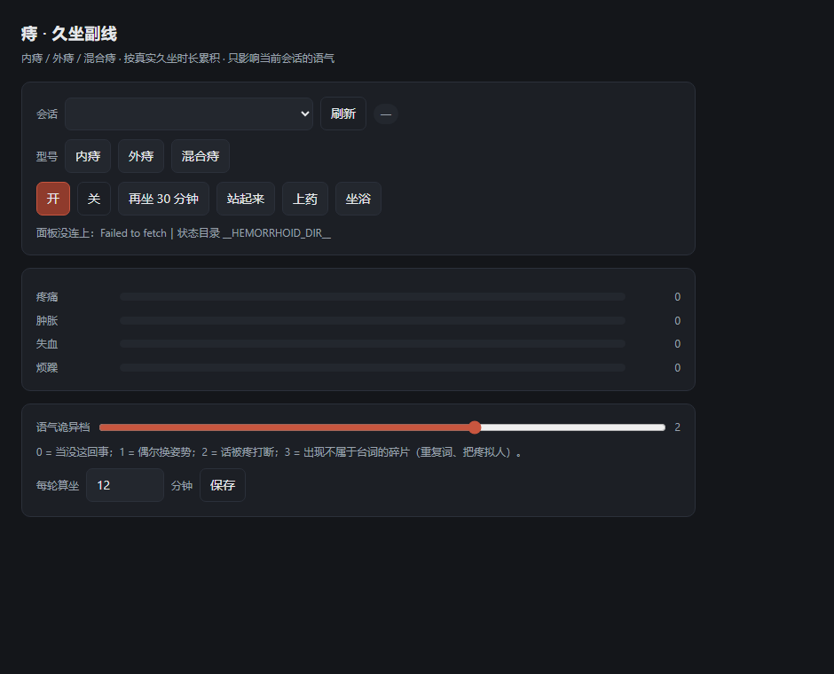

# dsh-hemorrhoid · 痔

给 DSH 加一条「久坐副线」：它按真实坐着的时长累积，然后**只改这一个会话的语气**。

> **这一份没有安装。** 目录在工作区里，profile 里没有它的任何行。要装看最下面一节，我没有执行过那些步骤。

## 三种型号

型号不是换个名字，是三种不同的惩罚形状：

| 型号 | 疼 | 血 | 语气上的表现 | 什么时候最难受 |
| --- | --- | --- | --- | --- |
| 内痔 `internal` | 几乎不涨 | 每坐满 30 分钟掉一次，累计慢了会头晕 | 慢半拍、说错词再改口、脸白 | 失血过 45 之后 |
| 外痔 `external` | 涨得最快 | 不掉 | 突然的短句、倒吸气、「没事」说得太快 | 疼过 78 就随时发作 |
| 混合痔 `mixed` | 涨得快 | 也掉 | 上一句正常、下一句突然变了 | 两样一起 |

**内痔不演疼**——它没痛感，演疼就穿帮了。它的惩罚在血和反应慢上。

## 状态怎么走

久坐是唯一的输入源：

- 每轮对话按真实耗时算坐着的分钟数（上限 `maxSitPerTurnMin`，防止挂机一夜把数值顶爆）
- 上下文被压缩也算「没起身」，+10 分钟
- 站起来 → 连坐清零，接下来 `standMinutes` 分钟内不算久坐
- 上药 → 立刻压 32 点疼，`ointmentMinutes` 分钟内疼痛不涨（但不是好了）
- 坐浴 → 退得比药膏多，尤其退肿

疼 / 肿 / 失血 / 烦躁四条线各自演化，`烦躁` 由疼和久坐一起喂。

## 注入：它到底改变了什么

开着的会话，在 **agent 自己的 scope** 里挂一条 `systemPrompt` context（`order: 160`）。别的会话看不见，关掉即 detach，状态文件留着。

注入块分六档：`calm`（一个字都不注入）/ `stiff`（只有坐太久）/ `ache` / `flare` / `dizzy` / `treated`。

两条防刷屏的闸：

- 冷却 `injectCooldownMin`（默认 8 分钟）内同一状态只说一次
- 同一状态最多压 `sameStateHoldFactor × 冷却`（默认 24 分钟）不说；过了允许复述一遍——因为确实还疼着

**诡异档** `eeriness` 0–3，是语气不对劲的上限：

- `0` 当没这回事
- `1` 最多一处细微表现（换坐姿、话说半句停一下）
- `2` 一句话说到一半被疼打断，允许「嘶」和没说完的句子
- `3` 允许出现不属于台词的碎片：同一个词重复两遍、把疼当成一个正在跟你说话的东西、突然改用第三人称说自己的身体

块里明确写着「别写进台词、别解释这是什么效果」——它要的是怪，不是解说。

## 七个工具

| 工具 | 干什么 | 用户会怎么说 |
| --- | --- | --- |
| `hemorrhoid_switch` | 开 / 关 / 看状态（只影响当前会话） | 「我得了痔疮」「别演了」 |
| `hemorrhoid_diagnose` | 选型号，顺手打开 | 「内痔」「混合痔」 |
| `hemorrhoid_stand` | 站起来，清连坐、压疼 | 「站起来走走」 |
| `hemorrhoid_ointment` | 上药 | 「抹点药」 |
| `hemorrhoid_sitz` | 温水坐浴 | 「泡一下」 |
| `hemorrhoid_sit` | 主动再坐 N 分钟（推剧情 / 调试） | 「再坐两小时」 |
| `hemorrhoid_status` | 读全部数值 | 「现在什么样」 |

没开的时候工具会拒绝，并在文本里给开法，不会假装成功。

## 面板

`http://127.0.0.1:<DSH 端口>/hemorrhoid`

- 选会话、选型号、开 / 关
- 四条数值条 + 连坐分钟 + 状态档
- 站起来 / 上药 / 坐浴 / 再坐 30 分钟
- 诡异档滑杆、每轮算坐多少分钟

同源校验（`Origin.host === Host`）+ `x-hemorrhoid-token` 头校验，令牌是状态目录里的 `panel-token.txt`。面板改的参数存 `panel-config.json` 叠加层，重启后还在。



## 数据

```
$DSH_HOME/hemorrhoid/          # 可用 DSH_HEMORRHOID_DIR 或 config.statePath 改
  sessions/<sid>.json          # 每个会话的身体状态 + 最近记录
  panel-config.json            # 面板改过的参数
  panel-token.txt              # 面板令牌
  inject.<sid>.txt             # 最近一次注入的块（排障用）
```

`pruneDays`（默认 45）之后自动清掉没动过的会话文件，只删文件名匹配 `^[A-Za-z0-9_-]+\.json$` 的。

## 参数总表

| 键 | 默认 | 说明 |
| --- | --- | --- |
| `enabled` | `true` | 全局总闸，关掉所有会话都没这回事 |
| `defaultEnabled` | `false` | 新会话默认开不开 |
| `personaName` | `大肥鱼` | 工具回执里的自称 |
| `type` | `mixed` | 型号 |
| `eeriness` | `2` | 诡异档 0–3 |
| `sittingPerTurnMin` | `12` | 一轮量不到真实时长时的兜底 |
| `maxSitPerTurnMin` | `90` | 一轮最多算多少分钟 |
| `swellPerSitMin` | `0.18` | 每分钟肿胀增量 |
| `irritationPerPain` | `0.25` | 烦躁随疼增长的系数 |
| `painStart` | `35` | 疼过这个值才有可感知注入 |
| `painFlare` | `78` | 疼过这个值随时发作 |
| `flareGain` | `28` | 一次发作顶多少疼 |
| `bleedPerSitMin` | `30` | 每坐满多少分钟掉一次血 |
| `bleedGain` | `8` | 每次掉多少 |
| `bloodRecoverPerHour` | `1.2` | 每小时自然回血 |
| `dizzyAt` | `45` | 失血到这里明显头晕 |
| `standMinutes` | `6` | 站起来后的免疫窗口 |
| `standPainRelief` | `10` | 站起来压多少疼 |
| `ointmentRelief` / `ointmentMinutes` | `32` / `25` | 药劲 |
| `sitzRelief` / `sitzSwellRelief` | `48` / `22` | 坐浴 |
| `idleDecayPerMin` | `0.35` | 不坐着时每分钟自然退疼 |
| `injectCooldownMin` | `8` | 注入冷却 |
| `injectMaxChars` | `380` | 注入块字数上限 |
| `injectOrder` | `160` | 在 systemPrompt 里的顺序 |
| `sameStateHoldFactor` | `3` | 同一状态最多压几个冷却周期 |
| `debugMode` | `false` | 面板 `reset` 动作需要它 |
| `statePath` | `''` | 空 = `$DSH_HOME/hemorrhoid` |
| `historyMax` | `300` | 每个会话留多少条记录 |
| `pruneDays` | `45` | 多久清一次冷会话 |

## 测试

```powershell
& "<DSH 自带的 node.exe>" --test test/pain.test.mjs test/plugin.smoke.mjs
```

（node 不在 PATH 时用 DSH 运行时里那个：`$env:USERPROFILE\.dsh\dsh-runtimes\...\node\bin\node.exe`。`node --test test/` 会报 MODULE_NOT_FOUND，必须显式列文件。）

38 条：25 条数值/文案，13 条装配 smoke（假 ctx 跑 `apply()`，验工具注册、注入挂载与卸载、事件结算、落盘、dispose）。

## 要装的话（我没装）

1. 把整个 `dsh-hemorrhoid` 目录放到 `%USERPROFILE%\.dsh\plugins\`
2. 在 `%USERPROFILE%\.dsh\profiles\desktop\package.json` 的 `dependencies` 加 `"dsh-hemorrhoid": "link:../../plugins/dsh-hemorrhoid"`
3. 同一个文件的 `dsh.profile.bundles` 数组里加 `"dsh-hemorrhoid"`
4. 在 `profiles\desktop\node_modules` 建一个同名 junction 指过去
5. `plugin_manager`：`set_bundle` target=`dsh-hemorrhoid` enabled=true
6. 重启一次 DSH（新插件要注入 jar 才生效）

回滚：反向做 1–5，删掉 `$DSH_HOME/hemorrhoid` 目录。

## 边界

- 注入是「给模型的提示」，不是硬开关。模型可以不听，但会读到。
- 它只动语气，不动工具权限、不动文件、不联网。
- 文案不写器官细节和医学描写，写的是坐不住、脸白、话被打断——要的是怪，不是科普。
- 每个会话一份状态，换会话身体是新的；这是故意的（不然并行干活会互相传染）。
